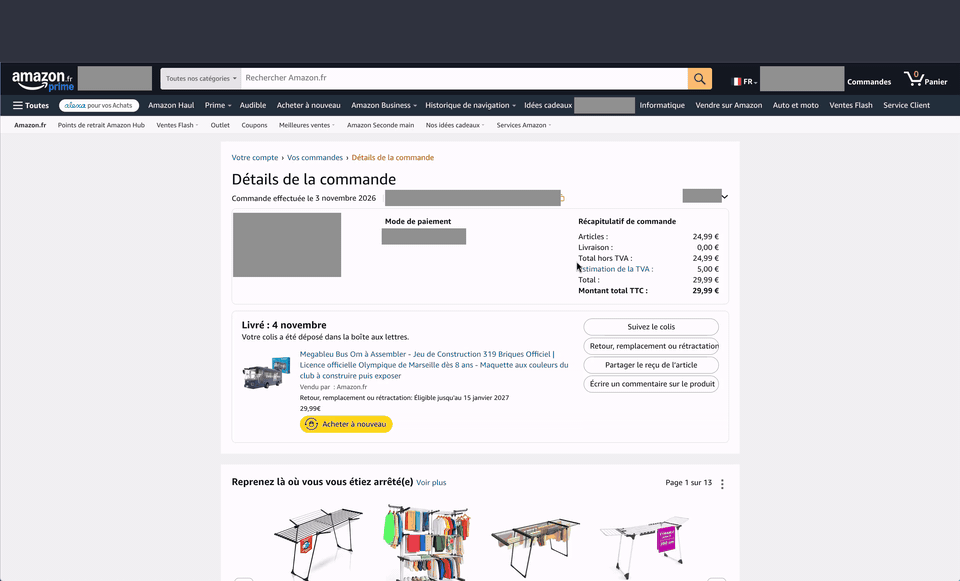

[English](README.md) | **Français**

<div align="center">


# homebox-clipper

**Transformez un achat en ligne en objet d'inventaire [HomeBox](https://github.com/sysadminsmedia/homebox), facture comprise, en un clic.**

[](https://github.com/Foufou-exe/homebox-clipper/actions/workflows/ci.yml)
[](https://github.com/Foufou-exe/homebox-clipper/releases)
[](https://sonarcloud.io/summary/new_code?id=Foufou-exe_homebox-clipper)
[](https://sonarcloud.io/summary/new_code?id=Foufou-exe_homebox-clipper)


</div>

---

**homebox-clipper** est un compagnon d'import pour les sites marchands en ligne : depuis la page
de commande, il détecte le produit, le prix, la date, le numéro de commande, le vendeur et la
facture PDF, puis crée l'objet dans votre instance HomeBox. Vous vérifiez, vous confirmez, c'est
rangé. **Boutiques :** Amazon.fr (prise en charge) et Amazon.de, Amazon.es, Amazon.it,
Amazon.com.be, Amazon.nl, Amazon.co.uk et Amazon.com (en test : vérifiées sur des pages de test
reconstituées, pas encore sur une vraie page de commande). D'autres marchands sont prévus et
l'architecture est faite pour en ajouter facilement : voir [MERCHANTS.fr.md](MERCHANTS.fr.md).

> [!NOTE]
> Rien n'est jamais envoyé sans votre confirmation, et rien n'est envoyé ailleurs qu'à **votre**
> instance HomeBox.

## Fonctionnalités

- **Détection automatique** d'une commande Amazon sur sa page de détail, dans la langue de la page ; un
  prix en livres ou en dollars est gardé tel quel, avec un avertissement avant confirmation (aucune
  conversion de devise).
- **Résumé modifiable** avant tout envoi, avec les champs non détectés signalés.
- **Import en 3 étapes** (objet, facture PDF, photo) ; commandes multi-articles, **ajout manuel** d'un PDF et **détection des doublons**.
- **Reprise sur erreur** : si la facture n'a pas pu être envoyée, réessayez sans créer de doublon.
- **Photo du produit** jointe à l'objet comme image principale (décochable par produit).
- **Choix de l'emplacement** parmi vos emplacements HomeBox, avec recherche ; le dernier utilisé est proposé.
- **Interface aux couleurs de HomeBox**, en thème clair, sombre ou automatique, en **anglais ou en français** selon la langue du navigateur.
- **Confidentialité** : aucun serveur intermédiaire ; la clé API est toujours chiffrée par votre
  phrase de passe (obligatoire) et n'est utilisée que par le service worker. HTTP n'est accepté que
  sur le réseau local.
- **Aucune permission générale** : pas d'accès permanent à un site ; l'accès à votre instance est
  demandé pour son adresse exacte uniquement.
- Liens **Support** et **GitHub** dans la fenêtre de l'extension et la page des réglages.

## Démo

D'une page de commande Amazon à un objet dans HomeBox, avec sa photo, sa facture et son emplacement :

<p align="center"></p>

## Marchands pris en charge

La liste à jour (pris en charge, partiels, prévus, demandés) est dans
**[MERCHANTS.fr.md](MERCHANTS.fr.md)**. Votre boutique n'y figure pas ? Ouvrez une
[demande de marchand](https://github.com/Foufou-exe/homebox-clipper/issues/new?template=merchant-request.yml).

## Installation

L'extension n'est pas encore publiée sur le Chrome Web Store : installez-la depuis une release, ou
compilez-la vous-même, puis chargez-la en mode développeur.

### Depuis une release (sans compilation)

1. Téléchargez `homebox-clipper-<version>-chrome.zip` depuis la
   [dernière release](https://github.com/Foufou-exe/homebox-clipper/releases/latest) (le fichier
   `.sha256` voisin permet de vérifier le téléchargement avec `sha256sum -c`).
2. Décompressez-le dans un dossier que vous conserverez (Chrome lit l'extension à cet endroit).
3. Dans `chrome://extensions` : activez le **Mode développeur**, cliquez sur **Charger l'extension non
   empaquetée** et sélectionnez ce dossier.

### Depuis les sources

Prérequis : Chrome ou Chromium, [Bun](https://bun.sh) et
[Node.js](https://nodejs.org) LTS, et une instance
[HomeBox](https://github.com/sysadminsmedia/homebox) (testé avec **v0.27.0**).

```bash
git clone https://github.com/Foufou-exe/homebox-clipper.git
cd homebox-clipper
bun install
bun run build      # → .output/chrome-mv3/
```

Puis dans `chrome://extensions` : activez le **Mode développeur**, cliquez sur **Charger
l'extension non empaquetée** et sélectionnez `.output/chrome-mv3/`. Guide complet :
[Installation](https://github.com/Foufou-exe/homebox-clipper/wiki/Installation).

## Configuration rapide

1. Dans HomeBox : **Profil** → **Clés API** → créez une clé (de préférence dédiée, avec une date
   d'expiration).
2. Dans l'extension (⚙ / *Options*) : saisissez l'adresse de votre instance, la clé API et une
   **phrase de passe** (10 caractères au moins, impossible à récupérer en cas d'oubli), puis
   **Tester et enregistrer**.
3. Ouvrez la page de détail d'une commande chez un marchand pris en charge, puis l'extension.

HTTPS est exigé, sauf pour une adresse du réseau local (HTTP accepté avec un avertissement), par
exemple `https://homebox.example.com` ou `http://localhost:3100`.
Détails : [Configuration](https://github.com/Foufou-exe/homebox-clipper/wiki/Configuration) et
[Utilisation](https://github.com/Foufou-exe/homebox-clipper/wiki/Usage).

## Documentation

Tout le détail est dans le **[wiki](https://github.com/Foufou-exe/homebox-clipper/wiki)** :
[Installation](https://github.com/Foufou-exe/homebox-clipper/wiki/Installation),
[Configuration](https://github.com/Foufou-exe/homebox-clipper/wiki/Configuration),
[Utilisation](https://github.com/Foufou-exe/homebox-clipper/wiki/Usage),
[Sécurité et confidentialité](https://github.com/Foufou-exe/homebox-clipper/wiki/Security-and-privacy),
[Dépannage et FAQ](https://github.com/Foufou-exe/homebox-clipper/wiki/Troubleshooting-and-FAQ),
[Architecture](https://github.com/Foufou-exe/homebox-clipper/wiki/Architecture).

## Contribuer

Les contributions sont bienvenues : pages mal détectées, nouveaux marchands, corrections.

```bash
bun run setup        # dépendances, .env de l'instance HomeBox locale, hook pre-push (au choix)
bun run homebox:up   # HomeBox sur http://localhost:3100
bun run dev
```

Avant chaque push, lancez `bun run ci` (la même vérification tourne sur GitHub pour les pull requests). Règles du projet,
conteneur de développement et façon de travailler : **[CONTRIBUTING.md](CONTRIBUTING.md)**.

## Changelog

Les évolutions notables sont dans **[CHANGELOG.md](CHANGELOG.md)**.

## Sécurité

Pour signaler une vulnérabilité, suivez **[SECURITY.md](SECURITY.md)** (pas d'issue publique).

Confidentialité : voir la **[politique de confidentialité](PRIVACY.fr.md)**.

## Crédits

- Le logo reprend la boîte de [HomeBox](https://github.com/sysadminsmedia/homebox)
  (© contributeurs HomeBox, licence AGPL-3.0), sans modification, à laquelle s'ajoute une pastille
  « + » propre à homebox-clipper (`src/assets/logo.svg`).
- Les couleurs de l'interface sont celles du thème par défaut de HomeBox.
- Icônes au trait inspirées de [Feather Icons](https://feathericons.com) (MIT).

## Licence

Code publié sous **[licence MIT](LICENSE)**. Le logo dérivé de HomeBox reste sous AGPL-3.0 (voir Crédits).

---

<sub>homebox-clipper est un projet indépendant, sans lien avec Amazon ni avec l'équipe HomeBox.</sub>

<sub>Dernière synchronisation avec README.md : 2026-11-09</sub>
