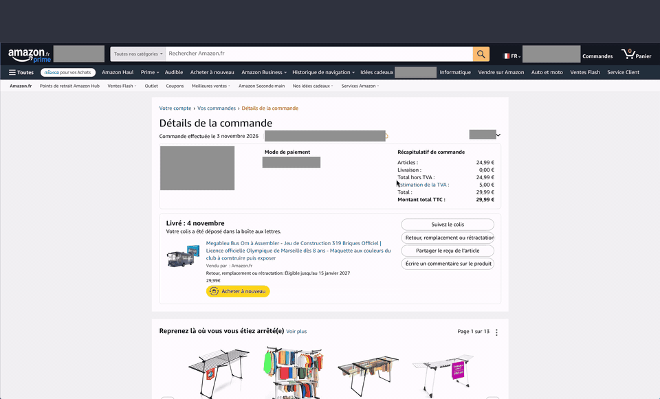

**English** | [Français](README.fr.md)

<div align="center">


# homebox-clipper

**Turn an online purchase into a [HomeBox](https://github.com/sysadminsmedia/homebox) inventory item, invoice included, in one click.**

[](https://github.com/Foufou-exe/homebox-clipper/actions/workflows/ci.yml)
[](https://github.com/Foufou-exe/homebox-clipper/releases)
[](https://github.com/Foufou-exe/homebox-clipper/discussions)
[](https://sonarcloud.io/summary/new_code?id=Foufou-exe_homebox-clipper)
[](https://sonarcloud.io/summary/new_code?id=Foufou-exe_homebox-clipper)


</div>

---

**homebox-clipper** is an import companion for online stores: from the order page, it detects the
product, price, date, order number, seller and PDF invoice, then creates the item in your HomeBox
instance. You review, you confirm, it is filed away. **Supported stores:** Amazon.fr (supported) and
Amazon.de, Amazon.es, Amazon.it, Amazon.com.be, Amazon.nl, Amazon.co.uk and Amazon.com (testing:
checked on reconstructed test pages, not yet on a real order page). More merchants are planned and the
architecture is built to add them easily: see [MERCHANTS.md](MERCHANTS.md).

> [!NOTE]
> Nothing is ever sent without your confirmation, and nothing is sent anywhere other than **your**
> HomeBox instance.

## Features

- **Automatic detection** of an Amazon order on its detail page, in the language of the page; prices in
  pounds or dollars are kept as is, with a warning before confirmation (no currency conversion).
- **Editable summary** before anything is sent, with undetected fields flagged.
- **3-step import** (item, invoice PDF, photo); multi-item orders, manual PDF attachment and **duplicate detection**.
- **Error recovery**: if the invoice could not be sent, retry without creating a duplicate.
- **Product photo** attached to the item as its main image (can be unticked per product).
- **Location choice** among your HomeBox locations, with search; the last one used is suggested.
- **HomeBox-colored interface**, in light, dark or automatic theme, in **English or French** depending on your browser language.
- **Privacy**: no intermediary server; the API key is always encrypted with your passphrase (required)
  and only used by the service worker. HTTP is accepted only on the local network.
- **No broad permission**: no permanent access to any site; access to your instance is requested
  for its exact address only.
- **Support** and **GitHub** links in the popup and the settings page.

## Demo

From an Amazon order page to an item in HomeBox, with its photo, invoice and location:

<p align="center"></p>

## Supported merchants

The up-to-date list (supported, partial, planned, requested) is in
**[MERCHANTS.md](MERCHANTS.md)**. Your store is not listed? Open a
[merchant request](https://github.com/Foufou-exe/homebox-clipper/issues/new?template=merchant-request.yml).

## Installation

The extension is not yet published on the Chrome Web Store: install it from a release, or build it
yourself, then load it in developer mode.

### From a release (no build)

1. Download `homebox-clipper-<version>-chrome.zip` from the
   [latest release](https://github.com/Foufou-exe/homebox-clipper/releases/latest) (the `.sha256` file
   next to it lets you check the download with `sha256sum -c`).
2. Unzip it into a folder you will keep (Chrome reads the extension from there).
3. In `chrome://extensions`: enable **Developer mode**, click **Load unpacked** and select that folder.

### From source

Prerequisites: Chrome or Chromium, [Bun](https://bun.sh) and
[Node.js](https://nodejs.org) LTS, and a [HomeBox](https://github.com/sysadminsmedia/homebox)
instance (tested with **v0.27.0**).

```bash
git clone https://github.com/Foufou-exe/homebox-clipper.git
cd homebox-clipper
bun install
bun run build      # → .output/chrome-mv3/
```

Then in `chrome://extensions`: enable **Developer mode**, click **Load unpacked** and select
`.output/chrome-mv3/`. Full guide:
[Installation](https://github.com/Foufou-exe/homebox-clipper/wiki/Installation).

## Quick setup

1. In HomeBox: **Profile** → **API keys** → create a key (preferably a dedicated one, with an
   expiry date).
2. In the extension (⚙ / *Options*): enter your instance address, the API key and a
   **passphrase** (at least 10 characters, impossible to recover if forgotten), then
   **Test and save**.
3. Open the detail page of an order at a supported merchant, then open the extension.

HTTPS is required, except for a local network address (HTTP accepted with a warning), e.g.
`https://homebox.example.com` or `http://localhost:3100`.
Details: [Configuration](https://github.com/Foufou-exe/homebox-clipper/wiki/Configuration) and
[Usage](https://github.com/Foufou-exe/homebox-clipper/wiki/Usage).

## Documentation

All the details are in the **[wiki](https://github.com/Foufou-exe/homebox-clipper/wiki)**:
[Installation](https://github.com/Foufou-exe/homebox-clipper/wiki/Installation),
[Configuration](https://github.com/Foufou-exe/homebox-clipper/wiki/Configuration),
[Usage](https://github.com/Foufou-exe/homebox-clipper/wiki/Usage),
[Security and privacy](https://github.com/Foufou-exe/homebox-clipper/wiki/Security-and-privacy),
[Troubleshooting and FAQ](https://github.com/Foufou-exe/homebox-clipper/wiki/Troubleshooting-and-FAQ),
[Architecture](https://github.com/Foufou-exe/homebox-clipper/wiki/Architecture).

## Contributing

Contributions are welcome: misdetected pages, new merchants, fixes.

```bash
bun run setup        # dependencies, local HomeBox instance .env, pre-push hook (optional)
bun run homebox:up   # HomeBox on http://localhost:3100
bun run dev
```

Before every push, run `bun run ci` (the same check runs on GitHub for pull requests). Project rules,
development container and workflow: **[CONTRIBUTING.md](CONTRIBUTING.md)**.

## Community

Questions, ideas, or just want to say hello? Join the **[Discussions](https://github.com/Foufou-exe/homebox-clipper/discussions)**: ask for help in Q&A, suggest ideas, show your setup. Please read the **[Code of Conduct](CODE_OF_CONDUCT.md)**, and see **[SUPPORT.md](SUPPORT.md)** for where to go for what.

## Changelog

Notable changes are listed in **[CHANGELOG.md](CHANGELOG.md)**.

## Security

To report a vulnerability, follow **[SECURITY.md](SECURITY.md)** (no public issue).

Privacy: see the **[privacy policy](PRIVACY.md)**.

## Credits

- The logo reuses the [HomeBox](https://github.com/sysadminsmedia/homebox) box
  (© HomeBox contributors, AGPL-3.0 license), unmodified, with a "+" badge specific to
  homebox-clipper added (`src/assets/logo.svg`).
- The interface colors are those of HomeBox's default theme.
- Line icons inspired by [Feather Icons](https://feathericons.com) (MIT).

## License

Code released under the **[MIT license](LICENSE)**. The logo derived from HomeBox stays under AGPL-3.0 (see Credits).

---

<sub>homebox-clipper is an independent project, not affiliated with Amazon or the HomeBox team.</sub>
